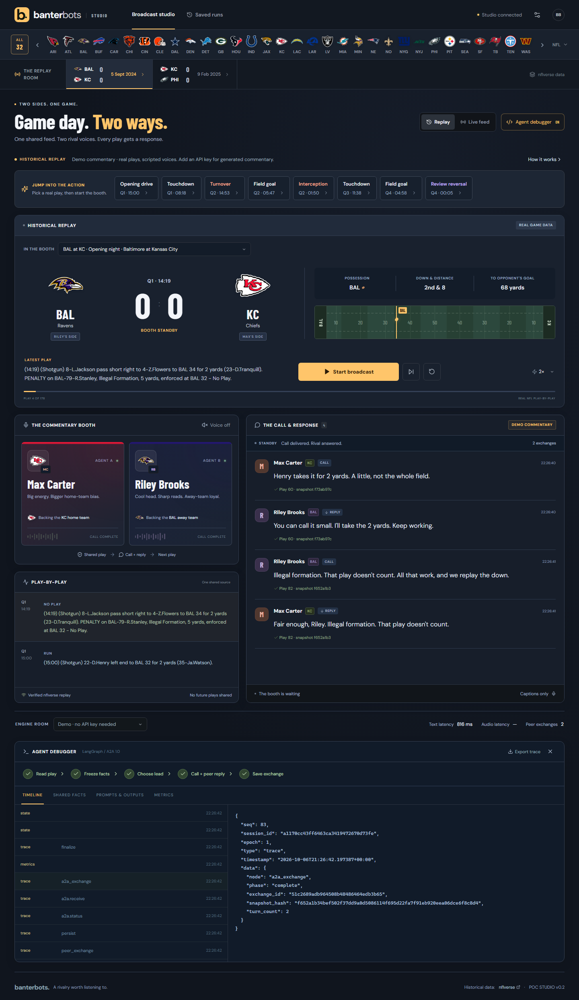

# BanterBots

Two NFL commentators. Opposing loyalties. One shared game stream.

BanterBots is a local React/Python POC with LangGraph orchestration and **real A2A protocol 1.0 HTTP communication** between independently addressable team agents. The dashboard includes all 32 teams, scores, game state, commentary, speech, and an inspectable run journal.



## Start on Windows

Install Python 3.12+ and Node.js 24+. From this folder:

```powershell
python tools/setup.py
python tools/dev.py
```

Open **http://localhost:5173**. Setup installs the locked dependencies into `.venv` and builds the frontend. The launcher uses `npm.cmd`, so PowerShell script execution policy does not need changing. Ctrl+C stops the services it started.

To run the built dashboard without Vite:

```powershell
python tools/dev.py --no-frontend
```

Then open **http://localhost:8000**. API documentation is at http://localhost:8000/docs.

| Service | Address |
|---|---|
| Dashboard development server | http://localhost:5173 |
| Coordinator / API | http://localhost:8000 |
| Max Carter / Team A | http://localhost:8001/.well-known/agent-card.json |
| Riley Brooks / Team B | http://localhost:8002/.well-known/agent-card.json |

## Repeatable demonstration

1. Keep **Historical replay** and **Demo commentary** selected. No credentials or live game are needed.
2. Select Baltimore at Kansas City (September 5, 2024). The studio starts at its opening offensive play, skipping the pregame marker.
3. Check **Agent network**: it should say **All systems working** with Studio, Max and Riley online. Press **Send a test play** (or **Advance one play**). The panel ticks off five steps as they happen: the studio sends the play to the lead agent, the lead writes its call, the lead sends that call to the other agent over A2A, that agent replies, and the lead returns both lines to the studio. Each A2A step shows its real task ID and timing, and the transcript marks every handoff. For raw payloads, open the debugger: both agents receive the same snapshot hash and the workflow strip shows each completed stage.
4. The host whose team has the ball does play-by-play. Before each snap, that host sets up the down, distance and field position (from the nflverse pre-snap data, never the result) and then calls the play; the other host adds colour. Quarter ends, halftime, the final whistle and finished drives get short two-host segments. Advance again, or press **Start broadcast** for a paced replay; the next play is prepared while the current one is heard. **Instant replay** calls a real touchdown, turnover, field goal or review immediately with one click. It opens a new run at that play, generates both reactions, then pauses. Restart returns to that run's chosen starting play.
5. Turn on speech using the speaker control beside Start or **Enable voice** in the booth. Demo mode is labelled **Preview voice**: robotic browser speech, which prefers the browser's natural neural voices when it has any. **Test voice** plays a short confirmation first. Sound starts off; enabling it speaks new commentary. **Use expressive voices** switches to the configured Azure broadcast. GPT-Live performs each validated line: it shouts and laughs on its own team's touchdowns, groans at the rival's, and builds suspense before a review. Every name and number stays as written, and anything the voice adds beyond a short reaction is cut before you hear it.
6. **Stadium on** plays a recorded crowd heard from the home side; the Super Bowl is neutral. These are CC0 recordings, with sources and licenses in `frontend/public/audio/LICENSES.md`. The crowd:
   - builds before third and fourth downs and in the red zone;
   - roars for home touchdowns and big plays;
   - groans, with a small pocket of away fans cheering, when the visitors score;
   - boos a flag on the home team, and never cheers a reversed touchdown.

   Designed stingers open the show and mark quarters, halftime and the final whistle. The crowd is not recorded at the selected game. **Crowd level** adjusts the mix independently of the voices, and the setting is remembered. The bed ducks about 10 dB under the hosts and reactions only about 4 dB. Muting, pausing, restarting, disconnecting or switching games stops every sound. If the browser blocks speech or cannot access an audio device, the booth switches voice off and shows the reason with a retry instruction.
7. **Your seat**:
   - pick a side;
   - **Cheer** or **Boo**, which plays at once in your section and reaches the hosts at the next play;
   - call the third or fourth down in the poll while the setup is heard;
   - **Ask the booth** a question, typed or dictated, which the colour host answers at the next break.

   Betting talk and profanity are declined. Dictation uses the browser's speech service, which may process audio in the cloud.
8. Inspect prompts, outputs, delivery plans, protocol tasks, event facts, errors, and timings. Export the run JSON for investigation.
9. Pause, restart, switch games, or reopen a saved run. Saved history is displayed without automatically regenerating or speaking old turns.

Each call/reply pair has its own quarter, clock, score, and expandable source play. Field context is labelled as the situation at the snap for nflverse replay; replay scores are post-play. Reading older exchanges stops automatic scrolling; **Back to the latest exchange** resumes it. Download a readable transcript from the conversation footer, or export the full trace from the debugger.

Keyboard shortcuts work when focus is outside buttons and inputs: **Space** plays/pauses, **Right arrow** advances one play, **M** toggles speech, and **D** toggles the debugger. The studio checks both agent services and disables starting if either is offline. An initial API failure offers **Retry connection**.

The replay uses real nflverse plays. Demo commentary is deterministic, event-grounded dialogue through the same LangGraph and A2A services as Azure OpenAI mode. It demonstrates the application workflow; model-driven naturalness requires the credentialed review below.

## Add Azure OpenAI later

Copy `.env.example` to `.env`, add your Azure OpenAI resource endpoint and key (Azure portal → your resource → **Keys and Endpoint**), and restart all services:

```dotenv
AZURE_OPENAI_ENDPOINT=https://your-resource.openai.azure.com
AZURE_OPENAI_API_KEY=your_resource_key
AZURE_OPENAI_TEXT_DEPLOYMENT=gpt-6-luna
AZURE_OPENAI_VOICE_DEPLOYMENT=gpt-live-1
```

The deployment settings are the **deployment names** you created on that resource, not model names. The services call the resource's v1 API (`<endpoint>/openai/v1/`), so no API version setting is needed.

Select **Azure OpenAI commentary** in the dashboard. The text deployment prepares short factual calls and replies. The voice deployment (`gpt-live-1`) delivers the spoken commentary through the server. Keys stay on the Python services.

The dashboard's **key configured** label confirms that the services loaded an endpoint and key; it does not verify that Azure accepts them. Restart all three Python services after editing `.env`. To check actual text commentary and peer replies with the running services:

```powershell
.\.venv\Scripts\python.exe tools/smoke.py --provider azure
```

This makes billed API calls and keeps voice disabled. An invalid key, wrong endpoint, missing deployment, or exhausted quota produces a failed check with the reason. Check voice separately using the dashboard's speaker control.

Personas are editable manifests under `personas/`. Max supports the home team; Riley supports the away team. The personalities use original identities and distinct stock voices. Validated `demo_delivery` settings control offline pace (`punchy` or `measured`), an ordered `analysis_focus` list (`situation`, `field_position`, `recent_sequence`, `score`), and `banter_frequency` from 0 to 0.6. Restart the Python services after editing manifests.

Voice behaviour has three optional settings in `.env`:

| Setting | Default | Effect |
|---|---|---|
| `VOICE_SESSION_MODE` | `persistent` | `persistent` keeps one GPT-Live session per host, closed after 25 s idle. `warm` opens a session while the text drafts. `fresh` uses one session per line. |
| `VOICE_PERFORMANCE` | performance | `strict` restores exact reading with no added reactions. |
| `VOICE_HOLD_MS` | `350` | Audio held back so a trailing ad-lib can be cut before it is heard. |

The partner drafts a reply while the call is spoken and starts speaking once every fact in the call has been heard. Each spoken line is audited with the same fact checks as its draft. The browser serializes audio segments, allows a short overlap on big moments, and acknowledges playback. The score and captions follow the audio. Run `tools/voice_audition.py` to hear how GPT-Live performs on your resource, and `node tools/listen_compare.mjs --label after` to record the reference scenarios and measure gaps, words per minute and cost per game (see [validation](docs/VALIDATION.md)).

## Live games

Select **Live ESPN** to load the current scoreboard. Pick a game and start the booth. The adapter polls scores every 15 seconds and selected-game play-by-play every 5 seconds, deduplicates IDs, and notices revised plays. Joining a game starts from its current context and latest play.

The default scoreboard date follows NFL Eastern time, including games still running after midnight in Europe. Scheduled games with no plays remain connected and waiting. A verified final game finishes after queued commentary; resuming avoids repeating an already-commented play while still accepting new revisions.

ESPN's endpoints are unofficial and best effort. The UI reports connection health, last successful poll, and provider errors. Halftime and a quiet field do not mean the feed disconnected. A failed live connection stays visibly failed; changing to historical replay is explicit.

Measure **feed delay**, **ingestion-to-first-text**, **ingestion-to-first-audio**, and exchange duration separately. A polling provider cannot guarantee commentary within 2.5 seconds of the actual snap.

## Checks

```powershell
.\.venv\Scripts\python.exe -m pytest -q
.\.venv\Scripts\python.exe -m ruff check backend tools tests
cd frontend
npm.cmd run check
npm.cmd run format:check
npm.cmd run build
npm.cmd exec playwright install chromium
npm.cmd run test:browser
```

Backend checks cover causal scores, reversed rulings, provider deduplication/corrections, shared snapshots, protocol exchanges, cancellation, and speech boundaries. Credential-free checks exercise the demo and protocol contracts. Live provider availability and actual Azure OpenAI speech require explicit smoke checks.

The browser checks use a fresh, isolated headless Chromium profile against the running services on port 8000. They verify desktop and mobile layout, the 32 team icons, actual A2A lead alternation, the debugger, restart, one-click highlights, transcript downloads, service recovery, keyboard navigation, failed transitions, saved runs and stale polling.

Frontend source is formatted for easier maintenance. Use `npm.cmd run format` in `frontend` after edits; `npm.cmd run format:check` verifies formatting.

With the services running, verify actual HTTP peer communication:

```powershell
.\.venv\Scripts\python.exe tools/smoke.py
```

This creates a fresh silent demo run, single-steps two plays, and checks lead alternation, identical snapshot hashes, peer reply linkage, and separate A2A task IDs.

## Debugging

- **Agent network** is the quick health check. It polls each agent's Agent Card every 10 seconds (or on **Check again**) and turns the latest exchange's protocol traces into plain steps. A step that stalls or turns red shows where the exchange broke.
- The integrated debugger shows observable workflow steps, factual context, requests, responses, prompts, and output.
- `.runtime/journal.sqlite` holds sessions and run events. Separate checkpoint/task databases support LangGraph and the A2A services.
- Audio chunks are transient; transcripts and segment metadata are saved. Reconnecting recovers written history without replaying old sound.
- Reset, stop, and game changes increment the run epoch, cancel outstanding work, and discard late messages/audio.
- Optional LangSmith tracing is configured in `.env.example`; local tracing works without an account.

See [architecture](docs/ARCHITECTURE.md), [data attribution](data/README.md), and the three original Word documents in `docs/`.

The audience-focused voice and sound changes are documented in [broadcast research and listening criteria](docs/BROADCAST_RESEARCH.md), with primary sources on sports prosody, conversational timing, clear audio mixes, and current voice API controls.

## Research references

- [nflverse historical play-by-play](https://github.com/nflverse/nflverse-data/releases/tag/pbp) and [data update schedule](https://nflreadr.nflverse.com/articles/nflverse_data_schedule.html).
- [Kaggle cleaned historical play-by-play example](https://www.kaggle.com/datasets/prestongrinstead/nfl-play-by-play-2015-2025-cleaned).
- [A2A Python SDK](https://github.com/a2aproject/a2a-python) and [LangGraph](https://docs.langchain.com/oss/python/langgraph/overview).
- [OpenAI GPT-Live](https://developers.openai.com/api/docs/guides/live) and [session controls](https://developers.openai.com/api/docs/guides/live-conversations).
- [ESPN/ManningCast production discussion](https://espnpressroom.com/feature/teamwork-in-action-monday-night-football-with-peyton-and-eli-espn-and-omaha-productions/) and [Ably commentary prototype](https://github.com/ably-labs/football-data-live-ai-commentary) informed interaction and UI design. Their code is not copied.
