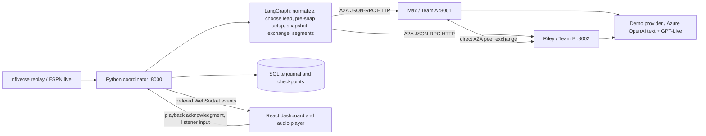

# Broadcast architecture

## Causality

Provider events have an identity, sequence, and revision. Each commentary exchange seals a snapshot containing only the current event, recent observed plays and previously emitted commentary. Both agents receive the same snapshot hash. Team allegiance changes interpretation, never the recorded outcome.

A pre-snap setup gets its own snapshot (`phase: "pre_snap"`) built from the play's nflverse down, distance, field position and clock plus the *previous* play's score. The description, flags, players, yards and scoring team are blanked when that snapshot is built, so a setup line cannot contain the result. `validate_draft` also rejects result words in setup lines. Between-play segments (`phase: "segment"`) carry totals computed only from plays that have already happened. Booth memory (remarks marked as bits, predictions and how they turned out, listener input) is snapshot data, so it is part of the hash.

Historical final-score columns are excluded. Post-play totals drive the scoreboard. Descriptions that contain a subsequently reversed touchdown are interpreted with normalized ruling flags. New live scores cannot mutate an already active exchange.

## Genuine agent communication

Each agent publishes an Agent Card at `/.well-known/agent-card.json` and implements protocol 1.0 JSON-RPC at `/a2a/jsonrpc` using the official SDK. Task lifecycle events move from submitted to working, artifact updates, and a terminal status. Agent task state is persisted.

The coordinator calls the lead's `exchange` mode. The lead generates its own call and then invokes the peer's `reply` mode over HTTP with the same snapshot and its observed utterance. A hop budget of one prevents recursive delegation. The debugger records both coordinator-to-agent and agent-to-peer protocol traffic.

**Roles.** The host whose team has the ball does play-by-play: that host's pre-snap `setup` line (hop 0, no reply) and the call. The other host is colour. Framing events (start, quarter ends, final) alternate. Between plays, the graph's `segments` node runs extra two-turn exchanges in `segment` mode: the intro, quarter, halftime and final segments, drive summaries (only at 2x speed or slower) and a listener question at the next break.

**Fast handoffs.** As soon as the lead starts speaking, it asks the peer over A2A for a `draft`: a written reply to the validated script that returns a `ReplyDraft` artifact and no turn. While the line plays, the lead watches its own observed transcript. Once every player, team and number word in the script has been heard, nothing has been misspoken (the same fact gates as `validate_draft`), and at most four script words remain, the lead starts the peer's `reply` with the words heard so far. The peer reuses its draft only if those spoken words carry every fact the draft relied on (`draft_mismatch`); otherwise it writes a new reply. The guarantee is that a reply only answers facts that were actually spoken. The early reply's voice streams immediately, but its finished turn is held until the lead's turn is published, so the transcript order never changes. If the lead's speech fails or misspeaks after an early start, that reply is withdrawn and its buffered audio discarded, and the normal reply path runs instead.

## Output and playback

Demo mode generates deterministic event-grounded lines and uses browser speech, preferring the browser's natural neural voices when it has any. It is labelled as a preview in the booth. Azure OpenAI mode prepares a grounded draft through the Responses API on the resource's v1 endpoint, and each agent's `VoiceBooth` performs it on GPT-Live. The Python server relays PCM16 at 24 kHz and actual transcript deltas as A2A artifacts, which the coordinator forwards over the dashboard WebSocket.

**Voice sessions.** `VOICE_SESSION_MODE` selects how GPT-Live sessions are used:

- `persistent` (default) keeps one session per host. Booth context arrives through `thinking.append` and each line through `instructions.append`. The session closes after 25 s idle, so a paused or live game is not billed for silence.
- `warm` opens a fresh session while the text model drafts and closes it after the line.
- `fresh` is the original one-session-per-line path.

In auditions, `persistent` reached first audio in 1.3–2.3 s and `warm` in 2.8–4.5 s.

**Performing the line.** The cue asks the voice to *perform* the validated line: every word in order, plus at most one short exclamation or a laugh. `VOICE_PERFORMANCE=strict` restores the exact-read cue. The audio is held back by `VOICE_HOLD_MS` (350 ms). If the voice keeps talking after the script is covered, that ad-lib is cut at the sample where its transcript begins, and only the line and short reactions reach the listener. Insertions in the middle of a line are traced, and the observed transcript gets the same fact audit as a draft. A violation sets `fact_flag`, and the partner's prompt then asks for a friendly correction. If the service stops a line for moderation before anything was heard, it is read once more without acting direction.

**Silence.** Quiet PCM frames are held back and released only when speech resumes. The boundary is `script_complete` (the end of the script heard, plus 300 ms of quiet), falling back to 1 s of observed silence or a per-moment duration cap. At most 120 ms of tail is sealed, so no listener waits through generated silence.

Speech generation and audience playback have separate ownership. Peer audio can arrive while the lead is playing, and the browser queues it until the lead's final sample plays. On big moments a different host may come in up to `overlap_ms` (at most 400 ms) early. The overlapped tail stays tracked, so pause and mute still stop it. The coordinator never leaves the booth waiting on a writer:

- **Setup and call.** A play's call is written while its setup line is being spoken. The graph moves on once the setup's voice segment exists, and the host's single voice line keeps the two in order.
- **Next play.** During a playing, voiced replay, the next play's setup is requested once this play's reply is on air. It is ready and buffered when the reply ends. This is skipped when a segment such as a drive summary must come first, and in single-step mode.
- **Lookahead.** The coordinator prepares at most one play ahead and uses playback acknowledgment to pace the replay. A play that was prepared but never heard is marked interrupted and called again on resume.

Because audio streams ahead of the screen, every non-audio event carries `present_after`: the last segment emitted before it. The browser schedules audio the moment it arrives, but its `Presenter` holds the score, captions, turns, polls and traces in order until that segment has finished playing (or after 30 s at most). The listener never sees the next touchdown before hearing it.

`backend/delivery.py` classifies each line as one of seven moments (setup, routine, notable, big, ruling, reset, segment). The moment sets word budgets and a delivery plan from the frozen corrected play, each host's allegiance, and the lead/reply role:

- A routine snap sits near 0.55 energy.
- A host's own big play explodes (energy 1.0 on a touchdown) with a shout, a stretched word and a laugh.
- The rival's big play gets a dramatic groan at 0.75.
- Rulings get suspense, never celebration.

The same plan carries the crowd cue heard from the home side (neutral at a Super Bowl):

- A build before third and fourth down, in the red zone, and late in close games.
- A roar or cheer when the home team benefits.
- A groan plus a pocket of away fans when it does not.
- Boos for a flag on the home team, but never for a reversal.
- Stingers for segments. Startup direction and per-call instructions remain separate from the exact script, and observed speech still owns the finalized transcript. The default speech cap is 14 seconds to allow natural pauses within short calls. Commentary uses low reasoning effort for the known `gpt-6-luna` deployment to reduce drafting time while retaining schema and factual validation; arbitrary deployment aliases keep their existing request options.

`frontend/src/soundscape.ts` mixes recorded CC0 crowd layers from `public/audio/` (the license, source and SHA-256 of each are in `LICENSES.md`), trimmed and loudness-matched by `manifest.json`:

- a looped bed with an equal-power crossfade at the seam;
- roars, cheers, a groan and boos;
- a band-limited, panned pocket of away fans;
- a pre-snap build that swells the bed;
- designed stingers from `tools/make_stingers.py`, which delay the voice until their tail.

The bed ducks about 10 dB under a voice and reactions only about 4 dB, so a touchdown call rides on the roar. A new reaction takes over from the previous one: a build gives way to the result. If the recordings cannot load, the earlier procedural texture plays instead. Streamed PCM and the crowd share a compressor. Everything then passes through a master stage (+4 dB make-up gain, a −4 dB limiter and a unity-slope soft clip with its ceiling at −1.4 dBFS). The finished mix therefore lands near the podcast target of −16 LUFS integrated, with true peaks under −1 dBTP, whether or not the crowd is on. `tools/measure_loudness.mjs` measures this (ITU-R BS.1770-4). Native browser speech is outside that audio graph, so its start/end callbacks control atmosphere ducking rather than routing the OS voice through the compressor. A crowd-level control and on/off preference are persisted locally. Voice preview does not start an idle stadium bed.

Delivery metadata reaches the browser through `turn.start` before streamed chunks and through the final turn for Demo speech. Reaction ownership includes session, epoch, exchange, event ID and revision. Cues wait for the first audible PCM sample or native speech start and are deduplicated across the two hosts. Pause, mute, reset, reconnect cleanup and game switching stop bed/cue sources and cancel pending phrase handoffs. Recovered history remains silent. Existing journal turns without delivery metadata remain readable.

Application silence detection provides a candidate speech boundary; it is not a provider turn-complete event. Closure tails remain part of the sealed segment. Capped, interrupted or unconfirmed-finalization segments are labelled. The actual account integration must be checked after credentials are supplied.

## Persistence, recovery and pressure

The journal saves snapshots, transcript turns, observable traces, and metrics. Large raw audio blobs are not saved. Reopening runs displays captured results; a new replay or restarted run explicitly generates new output.

Run events carry a sequence and epoch. Reconnect uses a cursor and marks recovered events historical, preventing repeated speech. Pausing/resetting/stopping invalidates in-flight work; game switching also clears queued audio. Slow browser streams disconnect and recover history instead of dropping arbitrary audio samples.

Per-session emission locks preserve sequence order across SQLite writes, polling, and agent artifacts. Saved HTTP/WS reconnects restore one shared broadcast object. Live baselines populate causal history before their latest play is queued. Delivered revision IDs are persisted so resuming or recovering a partial exchange cannot silently repeat spoken commentary. Older corrections exclude dialogue about later plays.

Browser speech has separate start and completion deadlines; missing callbacks cancel the segment and release ownership. Audio device failures, malformed PCM, and transport acknowledgement failures are reported to the studio. GPT-Live session writes have explicit deadlines, and cancellation never seals unfinished speech. The coordinator permits up to 60 seconds for the browser to play a lead/reply pair; acknowledgement normally releases it much earlier.

Live polling continues while a commentary exchange runs. Routine backlog is coalesced; important scoring, turnover, penalty and correction events are retained. Poll success and latest-play age are separate signals. No automatic live-to-replay substitution occurs.

The React workspace groups transcripts by exchange and snapshot hash, preserving each revision's score rather than applying the current scoreboard to old dialogue. Navigation stays locked through one-click highlight creation and stepping. WebSocket handlers are scoped to their owning socket; detached sockets cannot clear new audio or advance a new run's cursor. HTTP requests have a 45-second default deadline through body decoding, and caller cancellation is preserved.

## API contracts

- `GET /api/config`, `/api/teams`, `/api/games?mode=replay|live&date=YYYYMMDD`, `/api/health`.
- `POST /api/sessions` creates a paused broadcast with game, source, commentary provider, speed and voice settings.
- `POST /api/sessions/{id}/control` accepts play, pause, step, restart, stop or speed.
- `GET /api/sessions`, `/api/sessions/{id}`, `/api/sessions/{id}/export` inspect saved and current runs.
- `POST /api/sessions/{id}/listener` takes one listener action:
  - `side` (home, away or neutral);
  - `reaction` (cheer or boo, at most one every 0.5 s);
  - `poll_vote` with `poll_event_id`;
  - `question` (3–200 characters).

  Betting talk and profanity are declined with 422, and a second question while one is waiting gets 429. The input reaches the hosts as quoted booth data at the next break, never as instructions. A poll opens with the third- or fourth-down setup and stays open while that setup is heard. It is scored at the next break, and the browser never receives the result early.
- `WS /api/sessions/{id}/stream?since={seq}` carries typed snapshots, turns, captions, audio, segment seals, state, feed status, traces, metrics, `poll.open` and `listener` events. Non-audio events carry `present_after`. Clients send `playback.ack`.

Pydantic contracts in `backend/contracts.py` are the source of truth. Default deployment binds all services to localhost and supports one selected broadcast at a time. Public hosting, viewer authentication, video analysis and broadcast transcript ingestion are future work.
